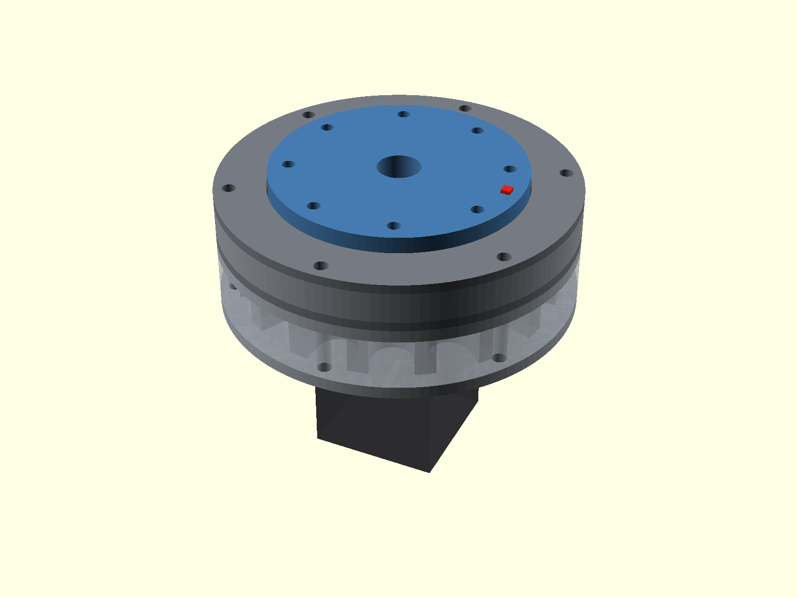
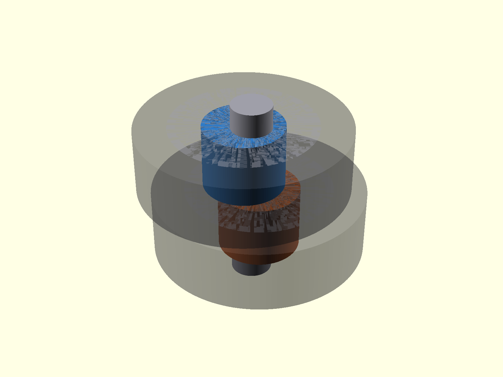

# Parametric Pancake Cycloidal Gearbox

A configurable **OpenSCAD cycloidal reducer** for NEMA stepper motors, with CNC-oriented bearing-supported builds and progressively simplified 3D-printable variants.

**Current design version: v1.8**

## Assembly

The output carrier is the external face flange, giving a short pancake package without a long projecting output shaft.

## What changed in v1.8

Two configurator areas were reworked:

1. **Simplified ring contacts now use case-rooted lobes.** The circular contact surface is preserved, but each printed lobe flares into a broad root that overlaps the case wall instead of hanging from a thin stem.
2. **Profiles are real OpenSCAD Customizer presets.** The companion JSON file contains named parameter sets. Selecting one fills the actual numeric and hardware fields in the Customizer, and those fields remain editable afterward.

### Case-rooted printed lobes

The lobe root can be tuned with `printed_lobe_root_fraction`, `printed_lobe_embed_depth`, and `printed_lobe_cavity_overlap`. The previous narrow-bridge geometry remains available as `Legacy narrow bridges`.

## Customizer presets

Keep the SCAD and JSON files together in `src/`. Use the **Preset** drop-down at the top of OpenSCAD's Customizer.

Supplied sets: NEMA17 Commodity R15; NEMA17 Light R11; NEMA17 Medium R21; NEMA17 Heavy R29; NEMA23 Light R11; NEMA23 Medium R18; NEMA23 Heavy R29; NEMA34 Light R11; NEMA34 Medium R21; NEMA34 Heavy R29.

Preset names use `R15`, `R18`, etc. instead of `15:1` so the Customizer does not confuse the colon with range syntax.

A preset updates the motor dimensions, ratio, torque class, catalog bearing selections, ring pitch, eccentricity, disc thickness, output-pin radius, plate thicknesses, housing radius, tie-bolt geometry, and center bore. After selection, each populated control remains editable.

See [`PROFILE_GUIDE_v1_8.csv`](docs/data/PROFILE_GUIDE_v1_8.csv).

## Motion

The motion section is a single animated GIF rendered from OpenSCAD.

The animation is prescribed kinematics, not a force/contact simulation.

## Input stack

The central gearbox input is the NEMA motor's own shaft. Each cycloid disc uses an eccentric sleeve phased 180° from the other.

## Simplification levels

| Level | Ring contact | Eccentric support | Output-pin contact | Output support |
| --- | --- | --- | --- | --- |
| **Full hardware** | Catalog ring bearings / sleeves | Ball bearings | Roller bearings | Large output bearing |
| **Integrated case lobes** | Printed case-rooted lobes | Ball bearings | Roller bearings | Large output bearing |
| **Direct pin and cam contact** | Printed case-rooted lobes | Direct sliding cam | Smooth pins | Large output bearing |
| **Bearingless printed journals** | Printed case-rooted lobes | Direct sliding cam | Smooth pins | Printed plain journal |

## Default commodity profile

The `NEMA17 Commodity R15` preset uses 624ZZ ring rollers on 4 mm rod, 625ZZ output rollers on 5 mm rod, 6000ZZ eccentric bearings, and a 6814ZZ output-flange bearing.

## Exploded and manufacturing views

## Validation

The v1.8 source was compiled locally across all 10 supplied presets and all four simplification modes: **40/40 combinations passed the current geometry assertions**.

These checks are geometric only. They are not torque, fatigue, thermal, bearing-life, or safety ratings.

## Project status

**Prototype / engineering development.** Before structural or safety-critical use, validate contact stress, output-pin loading, bearing life, fits, lubrication, fatigue, thermal behavior, fastener preload, and the actual motor shaft/pilot dimensions for the application.
