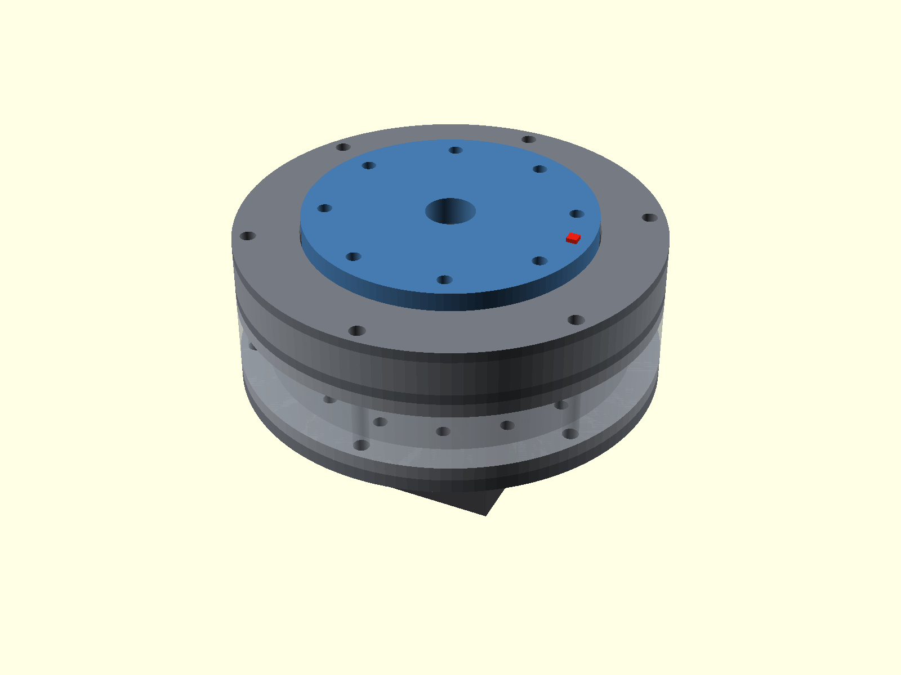
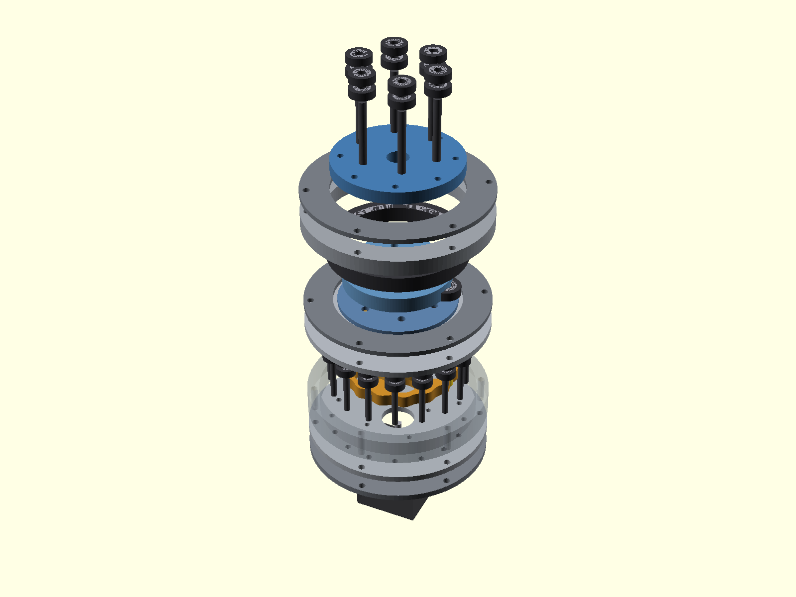
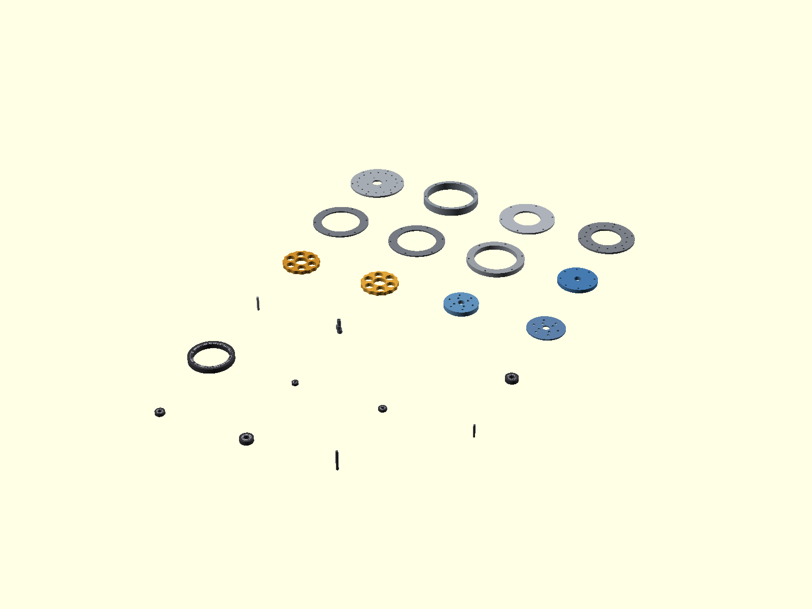
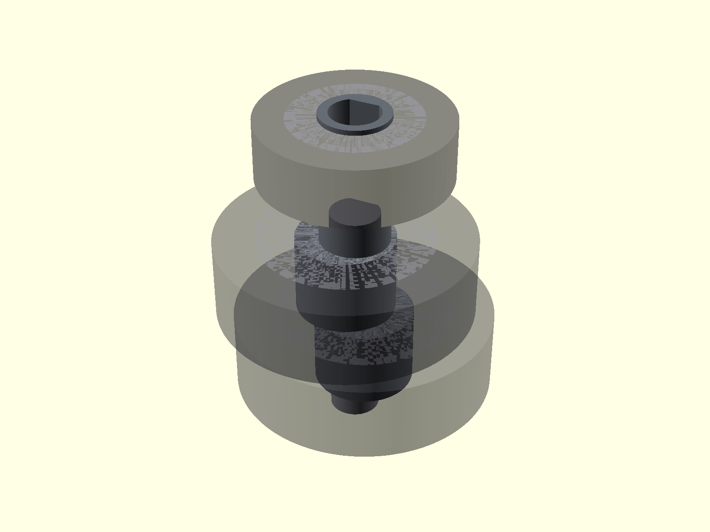
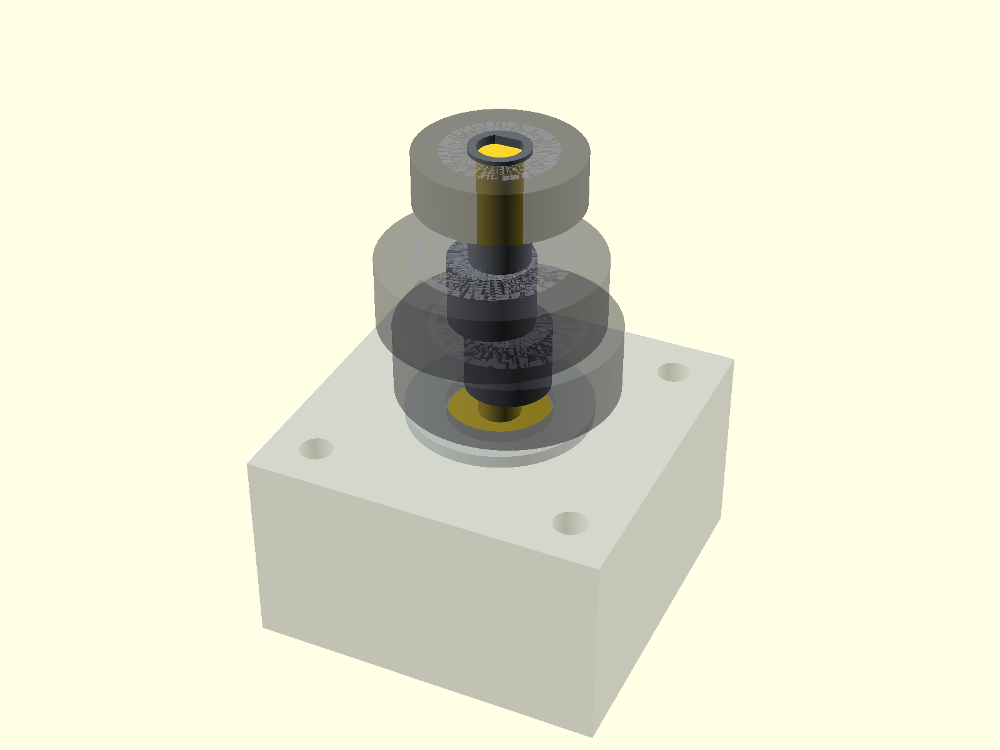
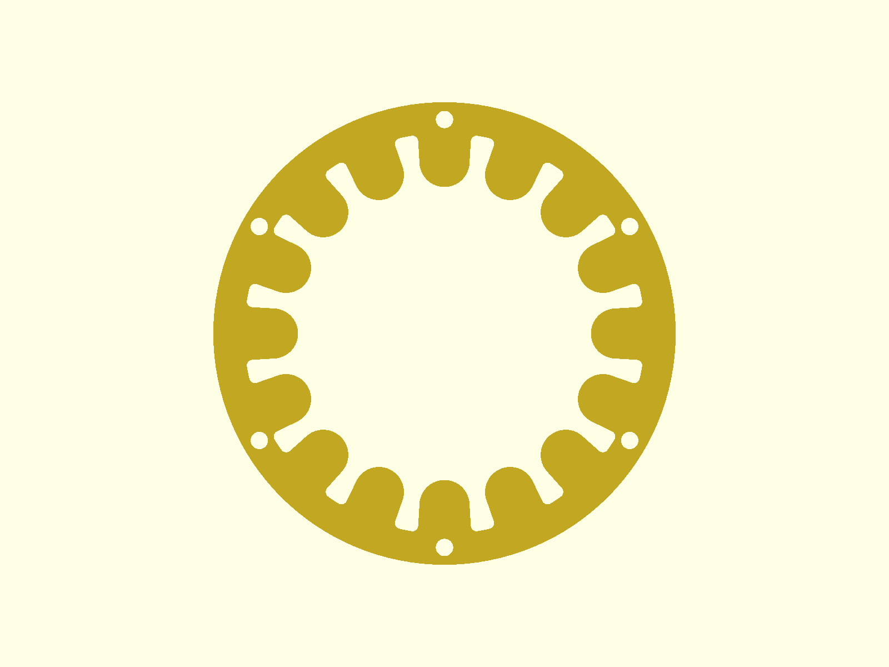
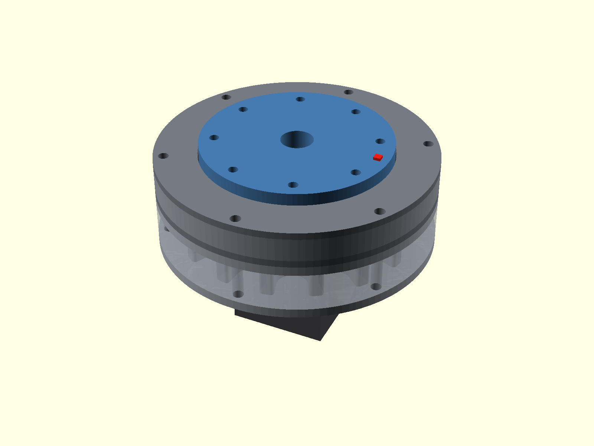
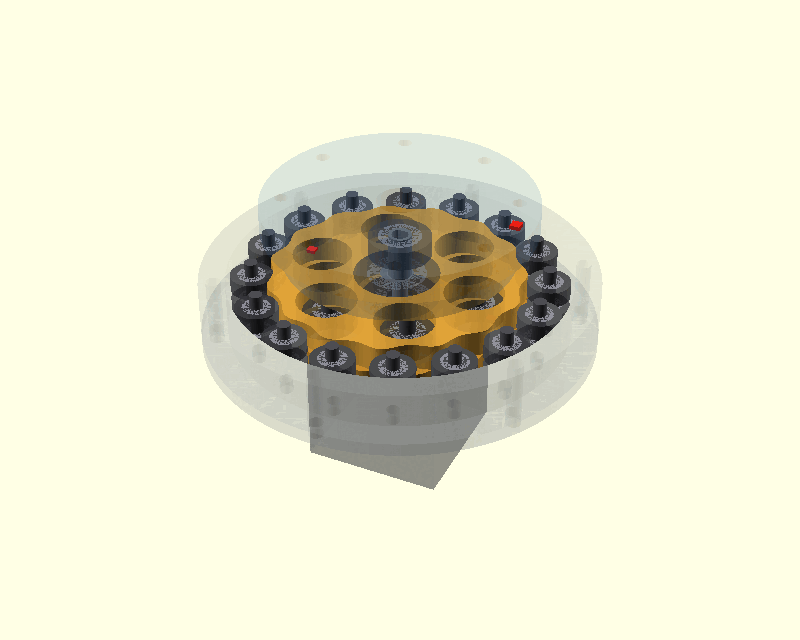

# Parametric Pancake Cycloidal Gearbox

A configurable **OpenSCAD cycloidal reducer** for NEMA 17 / 23 / 34 stepper motors. Level 0 is a bearing-supported design for CNC-machined aluminium plate; three cumulative simplification levels trade hardware for 3D-printability.

**Current design version: v1.13** · design file `src/cycloidal_gearbox.scad` · presets `src/cycloidal_gearbox.json`



The output carrier is the external face flange: a large 68-series bearing supports the rotating flange directly, so there is no projecting output shaft and no small-diameter bearing tower. The package stays short ("pancake").

## Quick start

1. Install [OpenSCAD](https://openscad.org/). Version 2021.01 works; 2023 or later with the Manifold backend renders 3D solids in seconds instead of minutes.
2. Open `src/cycloidal_gearbox.scad`. Keep the `.json` file beside it so the Customizer offers the presets.
3. Pick a preset from the Customizer **Preset** drop-down, then adjust any field. Presets write literal values into the controls, so nothing is overridden invisibly.
4. Set `part` to a view (`assembly`, `exploded`, `input_stack`, `layout_3d`, `motion_demo`) or to a part name, and `export_mode` to **2D profile** (DXF outline for CAM; blind operations come from the separate drill templates) or **3D solid** (STL with pockets, pilots and tapped-hole pilots).
5. The console shows the build report (sizes, selected bearings, facet error, minimum motor shaft length) and, with `spec_output`, the manufacturing report and hardware BOM as `SPEC|...` / `HARDWARE|...` lines.

From the command line:

```sh
openscad -o rear_plate.dxf -p src/cycloidal_gearbox.json -P "NEMA17 Commodity R15" -D 'part="rear_plate"' src/cycloidal_gearbox.scad
openscad -o disc.stl -D 'part="cycloid_disc"' -D 'export_mode="3D solid"' src/cycloidal_gearbox.scad
openscad -o /dev/stdout --export-format echo -D 'part="layout_2d"' -D 'spec_output="All parts"' src/cycloidal_gearbox.scad
```

Note that values in a `-p/-P` parameter set override `-D` definitions for any key the set contains, whatever the argument order.

## Architecture

MOTOR → eccentric input (one-piece double-eccentric sleeve on the motor shaft, or a machined coupled shaft) → two cycloid discs 180° apart → roller-covered output pins → OUTPUT FACE PLATE.



Nearly every custom part is flat plate of constant thickness: rear plate, case ring, front pin plate, two bearing race retainers, bearing carrier, two cycloid discs, output face plate, output hub ring and inner race retainer. The lathe parts are the eccentric sleeve and, optionally, the coupled input shaft and motor spacer.



### Input and its support



- **Direct motor shaft** (default): a one-piece sleeve with two eccentric journals 180° apart and a D-flat bore that takes torque from the motor shaft flat. No set screw; the sleeve is captured axially by the plates. A round bore with a forward set-screw collar, or two mirror-image D-bore sleeves, remain selectable.
- **Machined coupled shaft**: a stepped shaft with a female socket over the motor shaft and a registered motor spacer, either with the sleeve above on its core or with both eccentric journals **integrated** into the shaft. Use it when the motor shaft is too short for the stack (the model asserts the required length).
- **Front pilot bearing**: the sleeve or shaft continues into a bearing seated in the rear face of the output hub ring, so the eccentric is supported on both sides and the motor bearings do not carry its reaction load. Auto-selected from the catalog (the choice is echoed); a printed plain journal at levels 2-3.
- **Rear support bearing** (coupled shaft with separate sleeves): a bearing on the coupling hub inside the motor spacer.



See [INPUT_SHAFT_OPTIONS.csv](docs/data/INPUT_SHAFT_OPTIONS.csv) and [INTEGRATED_SHAFT_NOTES.md](docs/data/INTEGRATED_SHAFT_NOTES.md).

### Cycloid profile

The disc outline is the pin-centre epitrochoid offset inward by the roller radius plus the flank clearance, sampled by curvature-weighted arc length so the facet error is uniform (0.0005 to 0.004 mm at the default 1200 points; the report echoes it). The lobe count must be odd, because the second disc is the first turned 180°, and the model asserts this, the undercut margin, roller packing and the tie-bolt wall.

## Simplification levels

| Level | Ring contact | Eccentric support | Output-pin contact | Output support |
| --- | --- | --- | --- | --- |
| **Full hardware** | Catalog ring bearings on axles | Ball bearings + pilot bearing | Roller bearings | Large output bearing |
| **Integrated case lobes** | Printed case-rooted lobes | Ball bearings + pilot bearing | Roller bearings | Large output bearing |
| **Direct pin and cam contact** | Printed case-rooted lobes | Direct sliding cam, plain pilot journal | Smooth pins | Large output bearing |
| **Bearingless printed journals** | Printed case-rooted lobes | Direct sliding cam, plain pilot journal | Smooth pins | Printed plain journal |

Levels 1-3 are printed builds: the cycloid flank clearance, every bearing pocket and the motor pilot bore use print clearances (`print_radial_clearance`, `print_bearing_pocket_clearance`) instead of machined fits, the direct cam has its own diameter (`direct_cam_od_setting`), and the case lobes are filleted into the wall so the level 1 case can also be milled.





## Presets

| Preset | Ratio | Housing OD | Depth | Input |
| --- | --- | --- | --- | --- |
| NEMA17 Commodity R15 | 15:1 | 120 mm | 45.7 mm | direct, 22 mm shaft |
| NEMA17 Light R11 / Medium R21 / Heavy R29 | 11 / 21 / 29 | 112 / 126 / 163 mm | 38 / 44 / 53 mm | direct |
| NEMA23 Light R11 / Medium R19 | 11 / 19 | 134 / 146 mm | 44 / 53 mm | direct |
| NEMA23 Heavy R29 | 29 | 196 mm | 89 mm | coupled shaft, integrated eccentric |
| NEMA34 Light R11 / Medium R21 / Heavy R29 | 11 / 21 / 29 | 178 / 190 / 233 mm | 56 / 64 / 76 mm | direct |

Full values, including the selected bearings, are in [PROFILE_GUIDE.csv](docs/data/PROFILE_GUIDE.csv) (regenerate with `tools/profile_guide.py`). The commodity preset uses 624ZZ ring bearings on 4 mm rod, 625ZZ output rollers on 5 mm rod, 6000ZZ eccentric bearings, a 607ZZ pilot bearing and a 6814ZZ output bearing.

## Motion



View → Animate in OpenSCAD drives the input, orbits and counter-rotates the discs and advances the output at the reduction ratio. It is prescribed kinematics, not a contact simulation.

## Source layout

| File | Contents |
| --- | --- |
| `src/cycloidal_gearbox.scad` | Customizer parameters and the part selector (the only file the Customizer parses) |
| `src/cycloidal_gearbox.json` | Customizer presets |
| `src/lib/catalog.scad` | bearing catalog and NEMA frame tables |
| `src/lib/derived.scad` | derived geometry, fits, axial stack |
| `src/lib/cycloid.scad` | cycloid profile mathematics |
| `src/lib/checks.scad` | design-rule assertions and the preview build report |
| `src/lib/report.scad` | manufacturing report and hardware BOM |
| `src/lib/parts_2d.scad` | DXF outlines and drill templates |
| `src/lib/parts_3d.scad` | solids, lathe parts, hardware mock-ups |
| `src/lib/views.scad` | assembly, motion demo, exploded view, layouts |
| `tools/validate_presets.py` | compiles every preset × level × input architecture |
| `tools/render_docs.sh` | renders the images in this README |

## Validation

`python3 tools/validate_presets.py --csv out.csv` compiles all **10 presets × 4 simplification levels × 3 input architectures** and records the housing size, facet error, undercut margin, minimum shaft length and the selected support bearings. **116/116 applicable combinations pass**; the 4 remaining ones force the direct motor shaft onto `NEMA23 Heavy R29`, which specifies the coupled shaft because its stack needs more shaft than the motor has. Results: [validation_matrix.csv](docs/data/validation_matrix.csv). The GitHub workflow runs the same matrix on every push and pull request and re-renders the images on `main`.

These are geometric and assembly-clearance checks only. They are not torque, fatigue, thermal, bearing-life, shaft-coupling or safety ratings. The eccentric parts need appropriate material, bearing-journal tolerance and surface finish, and a machining method that holds both the eccentricity and the 180° phase.

## History

Each release is a git tag (`v1.10`, `v1.11`, `v1.12`, `v1.13`) with notes in `docs/`: [v1.13](docs/RELEASE_NOTES_v1_13.md) (library split, legacy removal, CI), [v1.12](docs/RELEASE_NOTES_v1_12.md) (input support bearings), [v1.11](docs/RELEASE_NOTES_v1_11.md) (geometry and fit corrections), [v1.8](docs/RELEASE_NOTES_v1_8.md), [v1.6](docs/RELEASE_NOTES_v1_6.md). Earlier single-file versions of the design are available at those tags.

## Project status

**Prototype / engineering development.** Nothing here is a certified or load-rated gearbox.
