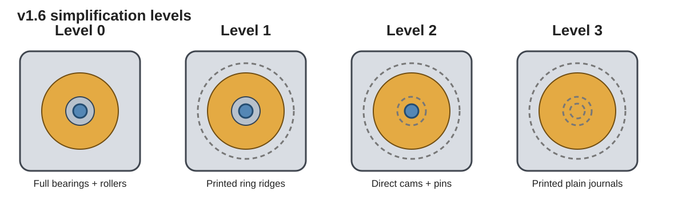
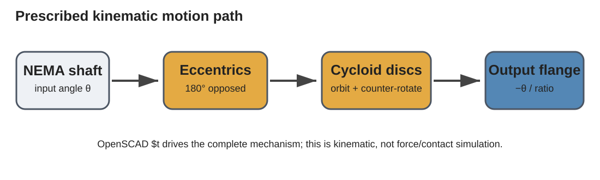
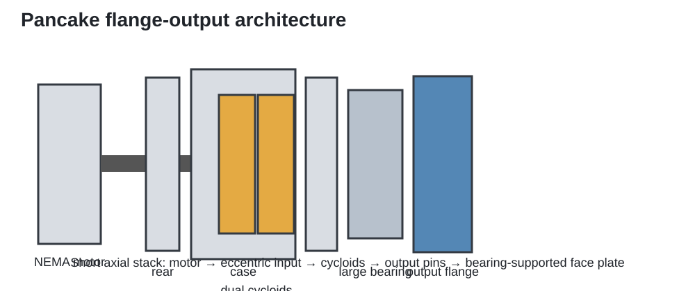
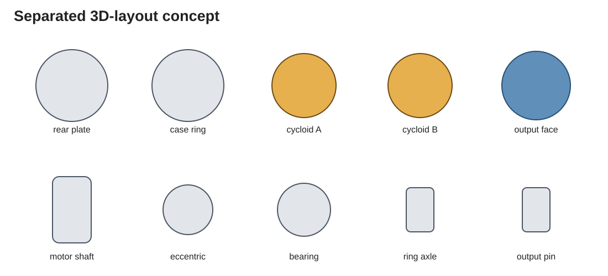

# Parametric Pancake Cycloidal Gearbox

A configurable **OpenSCAD cycloidal reducer** designed around a compact pancake form factor, NEMA stepper motors, real-world commodity bearings/shafting, CNC-friendly plate geometry, and progressively simplified 3D-printable variants.

**Current design version: v1.6**



## What this project is

The design started as a CNC-oriented aluminum cycloidal gearbox and evolved toward a short, face-output **pancake reducer**. The rotating output carrier is the external output flange, so a driven mechanism can bolt directly to the gearbox face instead of coupling to a long projecting output shaft.

The model is fully parametric in OpenSCAD and includes:

- NEMA 17, NEMA 23, and NEMA 34 starting profiles
- common reduction ratios and a manual/custom mode
- Light / Medium / Heavy construction presets
- catalog-driven bearing selections
- standard smooth-rod / dowel-pin diameters
- a commodity-focused NEMA 17 profile
- full assembly, exploded, 2D, 3D-layout, input-stack, and motion-demo views
- `$t`-driven kinematic animation
- CNC cut-list and hardware/BOM reporting
- four cumulative simplification levels for printed prototypes

## Motion



The OpenSCAD animation is a **prescribed kinematic animation**. It rotates the motor shaft and eccentric cams, orbits/counter-rotates both cycloid discs, and advances the output flange according to the selected reduction ratio.

In OpenSCAD:

1. Set `part = "motion_demo"`.
2. Enable `animate_preview`.
3. Open **View → Animate**.
4. Try 60–120 steps at 20–30 FPS.

This is not a force/contact simulation; it does not calculate bearing load, stress, friction, efficiency, or elastic deformation.

## Default commodity profile

The `NEMA17 Commodity 15:1` profile is intended to be buildable from common hobby/mechanical components rather than unusual specialty hardware.

| Function | Default hardware |
| --- | --- |
| Motor/input | NEMA 17, 5 mm motor shaft |
| Ring rollers | 624ZZ, 4 × 13 × 5 mm |
| Ring axles | 4 mm precision smooth rod |
| Output rollers | 625ZZ, 5 × 16 × 5 mm |
| Output pins | 5 mm precision smooth rod |
| Eccentric bearings | 6000ZZ, 10 × 26 × 8 mm |
| Output flange bearing | 6814ZZ, 70 × 90 × 10 mm |
| Reduction | 15:1 |

The central gearbox input shaft is the **stepper motor shaft itself**. Each cycloid disc uses an eccentric sleeve phased 180° from the other.

See [`STANDARD_PART_LIBRARY_v1_6.csv`](docs/data/STANDARD_PART_LIBRARY_v1_6.csv) and the default [`HARDWARE_BOM`](docs/data/HARDWARE_BOM_NEMA17_15_COMMODITY_FULL_HARDWARE_v1_6.csv) for the design's catalog/stock definitions.

## Simplification levels

The same gearbox geometry can be progressively simplified for printing and experimentation.

| Level | Ring contact | Eccentric support | Output-pin contact | Output support | Default gearbox bearings |
| --- | --- | --- | --- | --- | ---: |
| **0 – Full hardware** | Catalog ring bearings | Ball bearings | Roller bearings | Large output bearing | 47 |
| **1 – Integrated ring ridges** | Printed case ridges | Ball bearings | Roller bearings | Large output bearing | 15 |
| **2 – Direct pin/cam contact** | Printed case ridges | Direct sliding cam | Smooth pins | Large output bearing | 1 |
| **3 – Bearingless journals** | Printed case ridges | Direct sliding cam | Smooth pins | Printed plain journal | 0 |



### Intended use of simplified versions

Level 1 is the most practical compromise for a functional printed prototype. Levels 2 and 3 are primarily useful as kinematic demonstrators, educational models, or very light/low-speed prototypes. Direct printed sliding interfaces will have higher friction, wear, heat, backlash growth, and sensitivity to printer calibration.

## Profiles

The configurator includes named starting profiles for:

- NEMA 17 Light / Medium / Heavy
- NEMA 23 Light / Medium / Heavy
- NEMA 34 Light / Medium / Heavy
- NEMA 17 Commodity 15:1
- Parametric manual mode

See [`PROFILE_GUIDE_v1_6.csv`](docs/data/PROFILE_GUIDE_v1_6.csv) for the preset ratios and default bearing selections.

## OpenSCAD views

The `part` selector can generate functional or manufacturing-oriented views, including:

- assembled gearbox
- exploded assembly
- motion demo
- separated 3D layout
- 2D layout
- input/eccentric stack
- individual plates and cycloid discs
- drilling/pocket templates

The separated layout is useful for understanding what is purchased versus machined/printed. At the most simplified level it looks like this:



## CNC and manufacturing output

The model includes console reporting for:

- finished part thickness
- suggested stock thickness
- XY blank/envelope size
- critical bores and hole patterns
- bearing designations and dimensions
- rod/pin diameters and cut lengths
- hardware classification (`CATALOG`, `STANDARD_STOCK_CUT`, `STANDARD_FASTENER`, `FABRICATED`, `PRINTED_FEATURE`, etc.)

Useful generated reference files are under [`docs/data`](docs/data/).

The default full-hardware cut list is [`CUT_LIST_NEMA17_15_COMMODITY_FULL_HARDWARE_v1_6.csv`](docs/data/CUT_LIST_NEMA17_15_COMMODITY_FULL_HARDWARE_v1_6.csv).

## 3D-print clearance controls

Simplified variants expose adjustable clearances rather than assuming one printer/process:

- `print_radial_clearance`
- `print_axial_clearance`
- `printed_ring_bridge_width`
- `plain_output_journal_t`
- `motor_pilot_pocket_depth`

The default radial clearance is a starting point for ordinary FDM, not a universal fit. Resin, SLS, machined polymer, material choice, lubrication, printer calibration, and part orientation can all justify different values.

## Validation status

For v1.6, the 10 named profiles were compiled across all four simplification levels. **40/40 profile × simplification combinations pass the current geometric assertions.** The motion demo also compiles at all four simplification levels for the default commodity profile.

Passing these assertions means the model clears its current geometry/interference checks. It is **not a certified load rating**. Before using the gearbox for a structural or safety-critical application, bearing loads, output-pin loads, contact stresses, thermal behavior, lubrication, fatigue, and the actual motor shaft/pilot dimensions should be validated for the application.

## Repository layout

```text
.
├── README.md
├── src/
│   └── cnc_nema_cycloidal_gearbox_pancake_v1_6.scad
└── docs/
    ├── RELEASE_NOTES_v1_6.md
    ├── data/
    │   ├── PROFILE_GUIDE_v1_6.csv
    │   ├── SIMPLIFICATION_GUIDE_v1_6.csv
    │   ├── STANDARD_PART_LIBRARY_v1_6.csv
    │   ├── HARDWARE_BOM_...csv
    │   ├── CUT_LIST_...csv
    │   └── profile_simplification_validation_v1_6.csv
    └── images/
        └── rendered design previews
```

## Getting started

1. Install OpenSCAD.
2. Open [`src/cnc_nema_cycloidal_gearbox_pancake_v1_6.scad`](src/cnc_nema_cycloidal_gearbox_pancake_v1_6.scad).
3. Open the **Customizer** panel.
4. Choose a profile, ratio, torque class, ring-roller system, and simplification level.
5. Choose a `part` view.
6. Use the spec-output selector for manufacturing/BOM information in the OpenSCAD console.
7. Export the relevant 2D profiles or 3D geometry for your workflow.

## Design philosophy

The goal is not a single fixed gearbox. It is a common parametric model that can span:

- CNC-machined aluminum reducers with real bearings and hardened pins
- commodity-hardware prototypes
- progressively simplified 3D-printed demonstrators

while keeping the same underlying cycloidal geometry and making the hardware assumptions visible in the generated output.

## Versioning

This repository uses design-versioned source and generated files. The current source is **v1.6**; later revisions should retain prior releases/tags rather than silently replacing geometry.

## Project status

**Prototype / engineering development.** The model has geometric validation and prescribed kinematic animation, but it has not yet been assigned verified torque, life, efficiency, or safety ratings.