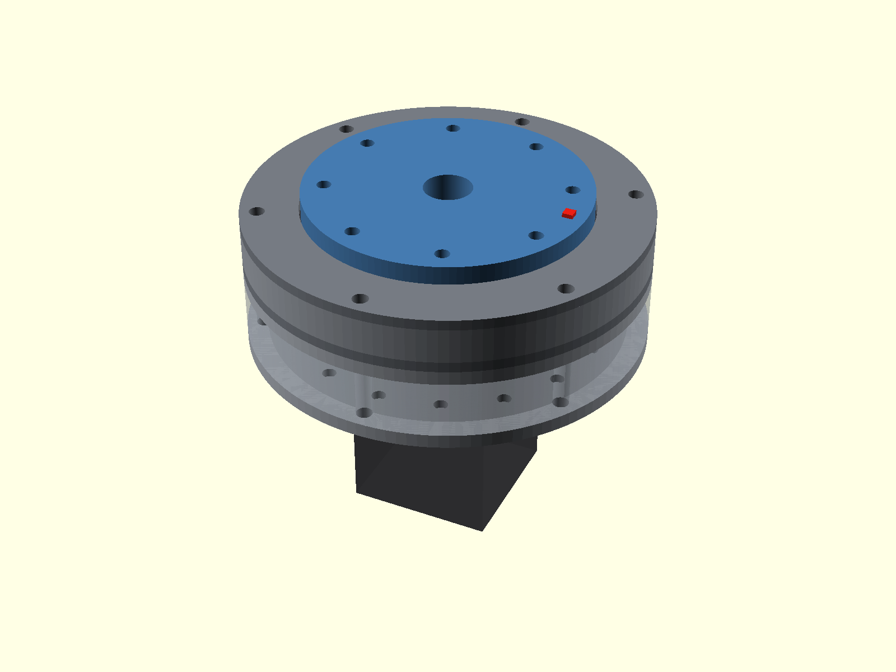
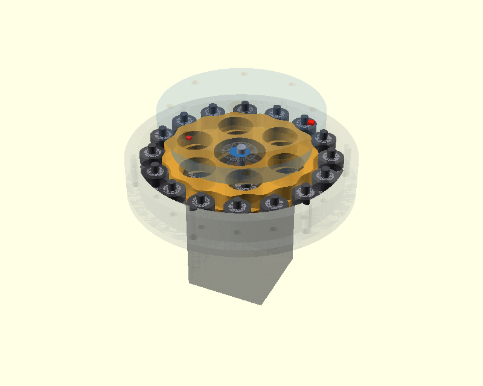
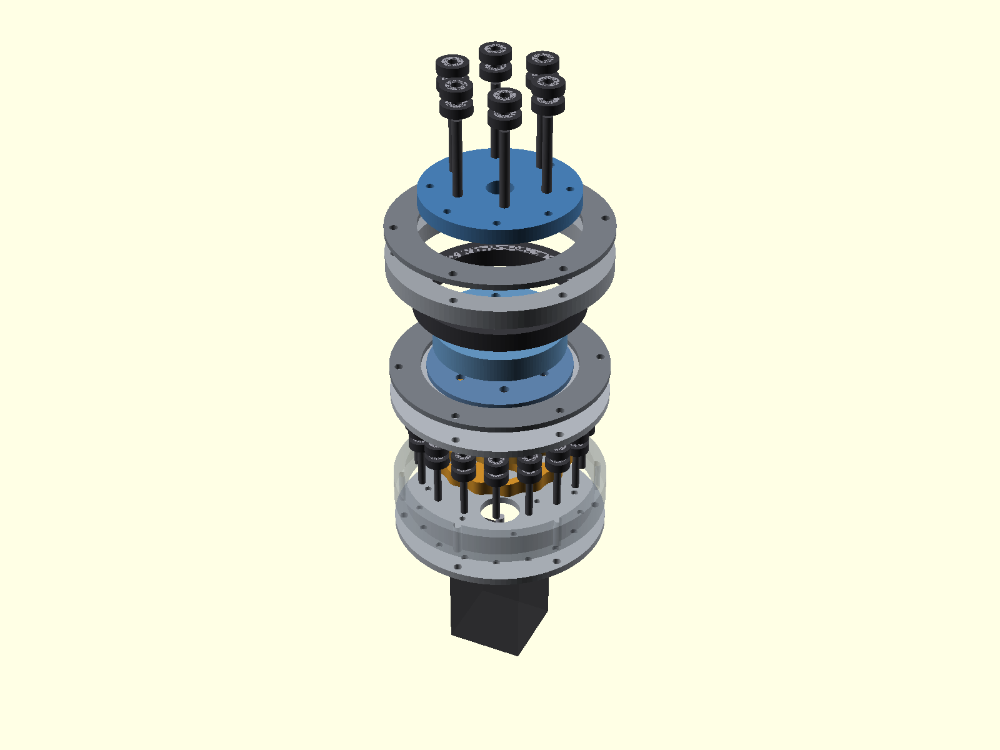
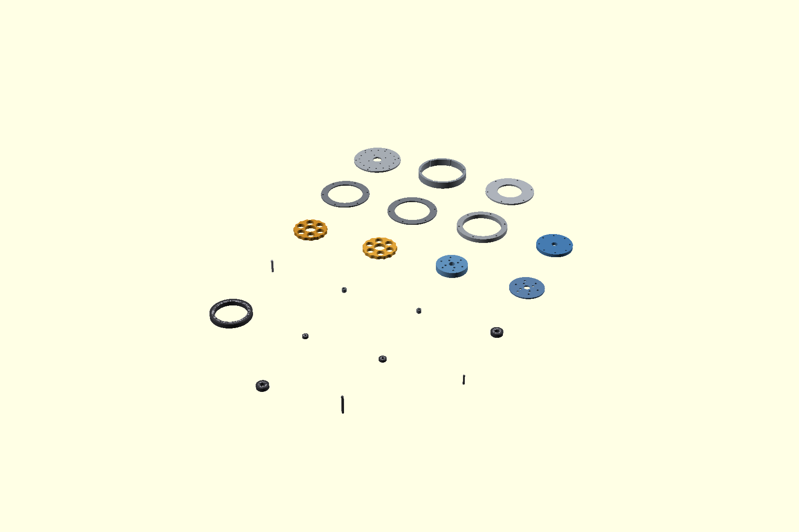

# Parametric Pancake Cycloidal Gearbox

A configurable **OpenSCAD cycloidal reducer** for NEMA stepper motors, with CNC-oriented bearing-supported builds and progressively simplified 3D-printable variants.

**Current design version: v1.12** (file `src/cnc_nema_cycloidal_gearbox_pancake_v1_10.scad` until the restructure lands)

## Assembly

The output carrier is the external face flange, giving a short pancake package without a long projecting output shaft.

## What changed in v1.12

v1.12 gives the eccentric input a bearing on the gearbox side. Up to v1.11 the one-piece sleeve or coupled shaft was cantilevered from the motor bearings, which then carried the full eccentric reaction load through the motor's own small bearings.

### Front pilot bearing

- The eccentric sleeve (direct shaft and coupled shaft with separate sleeves) or the integrated coupled shaft now continues forward into a **pilot bearing seated in the rear face of the output hub ring**, so the input is supported on both sides of the cycloid discs. The bearing is retained by the inner race retainer and the journal runs in the hollow output centre.
- `input_front_support` (Auto / Pilot bearing / None) and `front_pilot_bearing_select` (Auto or a catalog size, 625ZZ to 6806VV, or Custom). Auto picks the largest bearing whose hub pocket clears the hub clamp screws, whose journal fits through the output centre bore, and that the front eccentric bearing can slide over during assembly (the pilot is concentric, the bearing sits at the eccentricity, so the journal must be at least twice the eccentricity smaller than the bearing bore). On the sleeve the journal also keeps 0.8 mm of wall around the motor shaft bore. The choice is echoed; the NEMA17 default is a 607ZZ on a 7 mm journal. At simplification levels 2 and 3 the pilot is a printed plain journal.
- The motor shaft does **not** need to be longer: the sleeve journal extends beyond the shaft end and the minimum protrusion stays at the sleeve's drive bore.

### Rear support bearing

- For the machined coupled shaft with separate sleeves, `coupled_rear_support` seats a bearing on the coupling hub inside the registered motor spacer, inserted from the motor side against a shoulder behind the rear plate. `coupled_hub_od_setting` must equal the bearing bore; the NEMA23 and NEMA34 presets therefore use 17 and 25 mm hubs (6803VV / 6805VV) instead of 16 and 24 mm.
- The integrated double-eccentric shaft is supported by the front pilot plus the motor bearings; a rear bearing is not possible there because the eccentric journals must pass through the rear plate.

### Stack fix

- The optional set-screw collar of the round-bore sleeve is now limited by the same assembly rule (bearing bore minus twice the eccentricity); with a 5 mm motor shaft that leaves a 7.5 mm collar, which is why the D-flat bore is the default.

- The output hub ring was previously placed at the same axial position as the inner race retainer and overlapped it by the retainer thickness. The hub now sits in front of the retainer with a thickness equal to the output bearing width, so the inner race is clamped between the output face plate and the retainer through the hub as the drawings intended.
- The manufacturing report and BOM list the pilot and rear support bearings, pocket diameters with fit hints, and the journal extents on the sleeve and coupled shaft.

## What changed in v1.11

v1.11 is a correctness and manufacturability release driven by a full review of the v1.10 script. No new architecture; the fixes below apply to every preset.

### Geometry

- **Odd lobe count is now asserted.** The second cycloid disc is the first disc turned 180°, which only meshes with the ring when the lobe count is odd. Even ratios (the old `NEMA23 Medium R18` preset, or any even custom ratio) put the second disc's lobes on top of the ring rollers by up to 3 mm. The preset is now `NEMA23 Medium R19` and the ratio dropdown offers 11, 13, 15, 17, 19, 21, 25, 29.
- **Cycloid profile is resampled by curvature-weighted arc length.** The old uniform-parameter sampling left facet errors up to 0.36 mm in the valleys of the large presets, on the material side of the roller contact. The 1200-point profile now has a uniform facet error that the build report echoes (0.0005 to 0.004 mm across the presets).
- **Undercut, ring-packing growth, direct-shaft length and tie-bolt wall are asserted.** Several presets previously had their ring pitch circle silently pushed outward by the roller packing rule (up to 32 mm), and tie bolts that broke into the cycloid cavity wall. All presets were re-derived so the stored values are the values the model uses.

### Fits and simplified builds

- Simplification levels 1 to 3 are treated as printed builds: the cycloid-to-lobe flank clearance, every bearing pocket (`print_bearing_pocket_clearance`) and the motor pilot bore use print clearances instead of machined press fits.
- The direct-contact cam of levels 2 and 3 has its own diameter (`direct_cam_od_setting`, 20 to 32 mm by frame) instead of inheriting the omitted bearing's 10 to 30 mm bore.
- Printed case lobes are filleted into the wall (`printed_lobe_root_fillet`), so the level 1 case can also be milled; an optional end chamfer is available for 3D solids.
- The manufacturing report prints ISO-style fit hints beside every numeric bore.

### Eccentric input

- The default direct-shaft input now uses a **one-piece double-eccentric sleeve with a D-flat bore** (`eccentric_sleeve_style`, `eccentric_bore_style`). The two old sleeves were exactly as long as their bearings, so the set screw the BOM called for had nowhere to go. The one-piece sleeve fixes the 180° phase by machining, takes torque from the motor shaft flat and is captured axially by the rear and front plates. A round bore with a forward set-screw collar remains selectable, as do two separate (mirror-image, D-bore) sleeves.
- The rear keeper plate is chosen automatically when blind axle pockets would leave under 2 mm of plate floor.

### Export

- `export_mode = "3D solid"` exports any part as a solid with its blind pockets, pilot steps and tapped-hole pilots for STL. `2D profile` (default) keeps the DXF outlines and separate drill templates. Blind pockets are now cut from the same 2D drill templates that are exported.
- `tools/validate_presets.py` compiles every preset across all simplification levels and input architectures and writes a CSV.

## What changed in v1.10

v1.10 integrates the two eccentric cams into the machined coupled input shaft. The earlier separate-sleeve coupled input remains selectable.

### One-piece double-eccentric input shaft

Set input_shaft_mode to **Machined coupled shaft** and coupled_eccentric_mode to **Integrated double eccentric**.

The machined part combines the female socket for the existing motor shaft, coupling hub and locking screws, concentric shaft core, and **two integral eccentric journals machined 180° apart**. Their phase is therefore fixed by the part itself rather than by two independently adjusted eccentric sleeves.

The existing v1.9 registered motor spacer is retained:

The coupled_input_shaft part output now changes with coupled_eccentric_mode:

- **Integrated double eccentric** — one machined shaft, no eccentric sleeves or eccentric set screws.
- **Separate eccentric sleeves** — the v1.9 arrangement, easier to turn on simple equipment but requiring two sleeves to be phased 180° during assembly.

### Assembly path for the integrated shaft

A one-piece double-eccentric shaft creates an important assembly constraint: the rear cycloid bearing cannot pass over the front eccentric journal. v1.10 therefore sizes and checks the coupling end so the rear cycloid/bearing can be installed from the motor/coupling end.

The intended sequence is:

1. Press the rear eccentric bearing into the rear cycloid disc.
2. Slide that disc/bearing over the coupling end and onto the rear eccentric journal.
3. Slide the rear plate and registered motor spacer over the coupling end behind the rear disc.
4. Install the front cycloid/bearing from the front onto the front eccentric journal.
5. Couple the shaft socket to the motor shaft and tighten the radial locking screws.

The model asserts that the coupling hub is smaller than the rear bearing ID—or the direct-contact cycloid bore at simplified levels—by the configured assembly clearance.

### New integrated-shaft controls

- coupled_eccentric_mode
- integrated_coupling_hub_od_setting
- integrated_rear_assembly_clearance
- integrated_front_extension

The named NEMA presets populate starting values for the integrated coupling hub. All values remain editable after loading the preset.

See [INPUT_SHAFT_OPTIONS_v1_12.csv](docs/data/INPUT_SHAFT_OPTIONS_v1_12.csv), [PROFILE_GUIDE_v1_10.csv](docs/data/PROFILE_GUIDE_v1_10.csv), and [INTEGRATED_SHAFT_NOTES_v1_10.md](docs/data/INTEGRATED_SHAFT_NOTES_v1_10.md).

## Machined coupled input

input_shaft_mode still offers:

- **Direct motor shaft** — the shortest arrangement.
- **Machined coupled shaft** — a fabricated input with a female socket over the existing motor shaft and a registered motor spacer.

For the default NEMA17 commodity profile, the coupled-input starting point remains a 5 mm motor shaft, 10 mm socket depth, 22.5 mm motor offset, and M3 locking screws. In integrated mode the coupling hub is reduced to **9.5 mm OD** so the 10 mm-ID rear 6000ZZ bearing can pass over it during assembly.

## Case-rooted simplified lobes

The case-rooted printed lobe geometry remains the default simplified ring-contact system.

The contact circle stays at the correct cycloid generating radius while the root flares into the case wall for a stronger printed structure.

## Customizer presets

Keep the SCAD and JSON files together:

- src/cnc_nema_cycloidal_gearbox_pancake_v1_10.scad
- src/cnc_nema_cycloidal_gearbox_pancake_v1_10.json

Use the **Preset** drop-down in OpenSCAD's Customizer. The supplied sets are:

- NEMA17 Commodity R15
- NEMA17 Light R11
- NEMA17 Medium R21
- NEMA17 Heavy R29
- NEMA23 Light R11
- NEMA23 Medium R19
- NEMA23 Heavy R29
- NEMA34 Light R11
- NEMA34 Medium R21
- NEMA34 Heavy R29

A preset writes literal values into the motor, ratio, bearing, housing, cycloid, and input-coupling controls. After selection, every populated field remains editable.

## Motion

The animation is prescribed kinematics: it rotates the motor/input shaft and eccentric system, orbits and counter-rotates the two cycloid discs, and advances the output flange at the selected reduction ratio. It is not a force/contact simulation.

## Simplification levels

| Level | Ring contact | Eccentric support | Output-pin contact | Output support |
| --- | --- | --- | --- | --- |
| **Full hardware** | Catalog ring bearings / sleeves | Ball bearings | Roller bearings | Large output bearing |
| **Integrated case lobes** | Printed case-rooted lobes | Ball bearings | Roller bearings | Large output bearing |
| **Direct pin and cam contact** | Printed case-rooted lobes | Direct sliding cam | Smooth pins | Large output bearing |
| **Bearingless printed journals** | Printed case-rooted lobes | Direct sliding cam | Smooth pins | Printed plain journal |

The integrated double-eccentric shaft works with all four simplification levels. At Levels 2–3, its eccentric journals become direct sliding cam surfaces rather than bearing journals.

## Default commodity profile

The NEMA17 Commodity R15 preset uses:

| Function | Hardware |
| --- | --- |
| Motor/input | NEMA 17, 5 mm motor shaft |
| Ring rollers | 624ZZ, 4 × 13 × 5 mm |
| Ring axles | 4 mm precision smooth rod |
| Output rollers | 625ZZ, 5 × 16 × 5 mm |
| Output pins | 5 mm precision smooth rod |
| Eccentric bearings | 6000ZZ, 10 × 26 × 8 mm |
| Output flange bearing | 6814ZZ, 70 × 90 × 10 mm |
| Reduction | 15:1 |

## Views and manufacturing output

The OpenSCAD manufacturing report now includes integrated-journal OD and length, ± eccentric offsets, journal axial positions, minimum blank OD, rear assembly-passage diameter, socket geometry, set-screw drilling, registered spacer geometry, and motor offset.

When integrated mode is selected, eccentric_A and eccentric_B report quantity zero and are omitted from generated part geometry because those journals are machined into the input shaft.

## Validation

Run `python3 tools/validate_presets.py --csv out.csv` (needs `openscad` on the PATH). It compiles all **10 named presets × 4 simplification levels × 3 input/eccentric architectures**:

- direct motor shaft + separate eccentric sleeves,
- coupled shaft + separate eccentric sleeves,
- coupled shaft + integrated double eccentric.

**v1.12: 116/116 applicable combinations pass the OpenSCAD geometry assertions.** The 4 remaining combinations force the direct motor shaft onto `NEMA23 Heavy R29`, whose stack needs 24.5 mm of shaft on a motor that has 21 mm; that preset specifies the machined coupled shaft for exactly this reason and the script reports those as not applicable. See [profile_input_eccentric_simplification_validation_v1_12.csv](docs/data/profile_input_eccentric_simplification_validation_v1_12.csv) (the CSV also records which pilot and rear support bearings Auto selected for every combination).

Note on OpenSCAD's command line: values in a `-p/-P` parameter set override `-D` definitions for any key the set contains, regardless of argument order. The validation script therefore writes one derived parameter set per combination instead of mixing `-P` with `-D`.

OpenSCAD 2021.01 renders every 2D export and the preview in under a second, but 3D solids go through CGAL: a pocketed plate takes about 10 s and the full assembly several minutes. OpenSCAD 2023 or later with the Manifold backend renders the same solids in seconds.

These checks are geometric and assembly-clearance checks only. They are not torque, fatigue, thermal, bearing-life, shaft-coupling, journal-surface, or safety ratings. The one-piece eccentric shaft requires appropriate material, bearing-journal tolerance and surface finish, and a machining method capable of holding both eccentricity and 180° phase.

## Project status

**Prototype / engineering development.**
